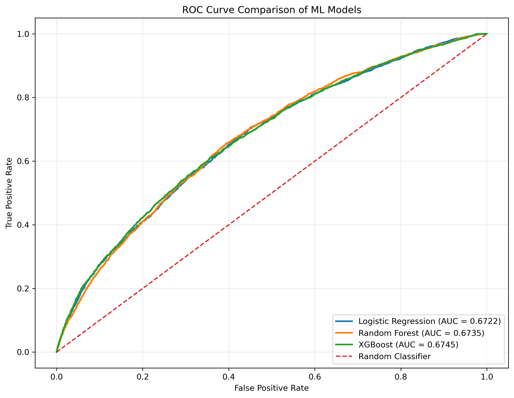

# 🏥 CarePredict — Hospital Readmission Prediction


A machine learning project that predicts whether a diabetic patient will be **readmitted to hospital within 30 days of discharge**. Three classifiers (Logistic Regression, Random Forest, XGBoost) are trained, tuned and compared, and the results are delivered through **CarePredict**, an interactive Streamlit dashboard with hospital analytics and a patient-level prediction tool.

> ⚠️ **Disclaimer:** This is an educational prototype. It is not clinically validated and must not be used for real patient-care decisions.

---

## 📑 Table of Contents

1. [Problem Statement](#-problem-statement)
2. [Dataset](#-dataset)
3. [Project Workflow](#-project-workflow)
4. [Results](#-results)
5. [CarePredict Dashboard](#-carepredict-dashboard)
6. [Repository Structure](#-repository-structure)
7. [Installation and Usage](#-installation-and-usage)
8. [Key Findings](#-key-findings)
9. [Limitations and Future Work](#-limitations-and-future-work)
10. [Tech Stack](#-tech-stack)

---

## 🎯 Problem Statement

Unplanned hospital readmissions within 30 days of discharge are costly for hospitals and often signal gaps in patient care. If high-risk patients can be flagged **before** they leave the hospital, clinicians can arrange follow-up care, medication review or discharge planning.

**Goal:** build and compare machine learning models that classify each hospital encounter as

| Label | Meaning |
|:---:|---|
| `1` | Readmitted within 30 days (`<30`) |
| `0` | Not readmitted, or readmitted after 30 days (`>30`, `NO`) |

---

## 📊 Dataset

**Source:** [UCI Machine Learning Repository — Diabetes 130-US Hospitals (1999–2008)](https://archive.ics.uci.edu/dataset/296/diabetes+130-us+hospitals+for+years+1999-2008)

| Property | Value |
|---|---|
| Encounters (rows) | 101,766 |
| Unique patients | 71,518 |
| Original columns | 50 |
| Input features used for modelling | 44 (8 numerical + 36 categorical) |
| Features after one-hot encoding | 2,344 |

**Original class distribution**

| `readmitted` | Share of encounters |
|---|---|
| `NO` | 53.91 % |
| `>30` | 34.93 % |
| `<30` | **11.16 %** |

After converting to a binary target, only about **11 %** of encounters are positive, so the problem is **highly imbalanced**. This drives many of the design choices below (class weighting, threshold tuning, F1 and recall as key metrics).

`IDS_mapping.csv` provides the human-readable descriptions of the admission type, discharge disposition and admission source IDs.

---

## 🔄 Project Workflow

```
Raw data → Cleaning → Patient-wise split → Encoding/Scaling → Tuning → Threshold selection → Test evaluation → Dashboard
```

### 1. Data Preprocessing (`notebooks/preprocessing.ipynb`)

- Replaced `?` placeholders with missing values.
- Dropped identifiers (`encounter_id`, `patient_nbr`) from the feature set.
- Dropped constant columns (`examide`, `citoglipton`) and `weight` (almost entirely missing).
- Filled missing categorical values (`race`, `payer_code`, `medical_specialty`, `diag_1–3`) with `"Unknown"`, and missing lab results (`max_glu_serum`, `A1Cresult`) with `"Not Tested"`.
- Created the binary target: `readmitted == "<30"` → 1, otherwise 0.
- Treated `admission_type_id`, `discharge_disposition_id` and `admission_source_id` as **categorical** (they are codes, not quantities).
- Built a `ColumnTransformer`: `StandardScaler` for numerical columns and `OneHotEncoder(handle_unknown="ignore")` for categorical columns, fitted on training data only.

### 2. Leakage-Free Data Splitting

The same patient can appear in several encounters. A random split would put the same patient in both training and test sets and inflate the scores. To prevent this, **`GroupShuffleSplit` was used with `patient_nbr` as the group**:

| Split | Purpose | Notes |
|---|---|---|
| Training | Fit the models | Hyperparameter tuning uses a validation subset of it |
| Validation | Tune hyperparameters and select decision thresholds | Taken from the training patients |
| Test (20 153 encounters) | Final, untouched evaluation | 20 % of patients |

The notebooks explicitly verify that **no patient appears in more than one split**.

### 3. Models and Hyperparameter Tuning (`notebooks/model_training.ipynb`)

| Model | Tuned settings | Selected configuration |
|---|---|---|
| **Logistic Regression** | `C` ∈ {0.01, 0.1, 1, 10}, `class_weight="balanced"` | `C = 0.01` |
| **Random Forest** | 4 configurations of depth, leaf size and class weighting | 150 trees, `max_depth=None`, `min_samples_leaf=10`, `class_weight="balanced_subsample"` |
| **XGBoost** | 4 configurations of trees, depth, learning rate, subsampling, with `scale_pos_weight` | 400 trees, `max_depth=4`, `learning_rate=0.03`, `min_child_weight=3`, `subsample=0.9` |

Class imbalance was handled with class weights / `scale_pos_weight`. **SMOTE oversampling** was also evaluated for XGBoost and compared against the weighted approach on the validation set.

### 4. Decision Threshold Optimisation

The default threshold of 0.5 is not suitable for imbalanced data. For each model, the threshold that **maximises F1 on the validation set** was chosen using the precision–recall curve, then applied once to the untouched test set.

| Model | Selected threshold |
|---|:---:|
| Logistic Regression | 0.5032 |
| Random Forest | 0.5146 |
| XGBoost | 0.5376 |

---

## 📈 Results

All metrics are computed on the **same held-out, patient-separated test set** (20,153 encounters, about 10.7 % positive).

| Model | Accuracy | Precision | Recall | F1-Score | ROC-AUC |
|---|:---:|:---:|:---:|:---:|:---:|
| Logistic Regression | 0.6805 | 0.1767 | **0.5449** | 0.2669 | 0.6722 |
| Random Forest | **0.7560** | **0.1959** | 0.4142 | 0.2660 | 0.6735 |
| **XGBoost** | 0.7302 | 0.1917 | 0.4751 | **0.2732** | **0.6745** |

**Confusion matrices** (test set, validation-selected thresholds)

| Model | True Negatives | False Positives | False Negatives | True Positives |
|---|:---:|:---:|:---:|:---:|
| Logistic Regression | 12,542 | 5,460 | 979 | 1,172 |
| Random Forest | 14,344 | 3,658 | 1,260 | 891 |
| XGBoost | 13,693 | 4,309 | 1,129 | 1,022 |

### ROC Curve Comparison



### Interpretation

- **XGBoost** gives the best F1-score and ROC-AUC, so it is the default model in the dashboard.
- **Logistic Regression** catches the most true readmissions (highest recall), at the cost of more false alarms. This is useful if missing a high-risk patient is the bigger concern.
- **Random Forest** has the highest accuracy and precision, but misses more readmissions.
- The three models perform very similarly (ROC-AUC ≈ 0.67). This reflects how hard the task is: 30-day readmission depends on many factors that are not recorded in administrative data. Accuracy alone is misleading here, since predicting "no readmission" for everyone would already score about 89 %.

### Most Influential Features (XGBoost)

The strongest predictors were the **number of previous inpatient visits** and several **discharge-disposition categories** (for example discharge to home, to a rehabilitation facility, or to hospice), followed by the primary diagnosis group and whether diabetes medication was prescribed. The full ranking is available in the dashboard under *Feature Importance*.

---

## 💻 CarePredict Dashboard

The Streamlit app (`frontend/app.py`) has ten sections, available from the sidebar:

| Section | Description |
|---|---|
| **Hospital Overview** | Key metrics (encounters, 30-day readmission rate, average stay) and readmission distribution |
| **Patient Analytics** | Age, gender and race patterns against readmission |
| **Admission Analytics** | Admission type, discharge disposition, hospital stay and prior visits |
| **Diagnosis Analytics** | Top diagnoses, medical specialties and medication usage |
| **Correlation Analysis** | Correlation heatmap and feature distributions |
| **Model Comparison** | Side-by-side metrics for all three models, with charts |
| **Model Evaluation** | Confusion matrix, classification metrics and ROC curves for the chosen model |
| **Feature Importance** | Top 20 XGBoost features |
| **Patient Assessment** | Form to enter encounter details and generate a prediction with any of the three models |
| **Prediction Results** | Model score vs decision threshold, risk flag, and downloadable CSV report |

---

## 📁 Repository Structure

```
Hospital-Readmission-Prediction/
├── datasets/dataset1/
│   ├── diabetic_data.csv            # Original UCI dataset
│   ├── IDS_mapping.csv              # ID → description lookup
│   └── preprocessed_initial.csv     # Cleaned dataset
├── notebooks/
│   ├── dataset1_analysis.ipynb      # Exploratory data analysis
│   ├── preprocessing.ipynb          # Cleaning, splitting, encoding
│   └── model_training.ipynb         # Tuning, thresholds, evaluation
├── models/                          # Trained models and saved artifacts
│   ├── logistic_regression_model.pkl
│   ├── random_forest_model.pkl
│   ├── xgboost_model.pkl
│   ├── preprocessor.pkl
│   ├── model_thresholds.pkl
│   └── ...                          # metadata, evaluation and feature files
├── results/
│   ├── model_comparison.csv
│   └── roc_curve_comparison.png
├── frontend/
│   └── app.py                       # Streamlit dashboard
├── .gitignore
└── README.md
```

---

## ⚙️ Installation and Usage

### 1. Clone the repository

```bash
git clone https://github.com/nischithpl/Hospital-Readmission-Prediction.git
cd Hospital-Readmission-Prediction
```

### 2. (Optional) Create a virtual environment

```bash
python -m venv venv
source venv/bin/activate        # Windows: venv\Scripts\activate
```

### 3. Install dependencies

```bash
pip install pandas numpy scikit-learn xgboost imbalanced-learn joblib matplotlib plotly streamlit jupyter
```

> Use the same scikit-learn and XGBoost versions that were used for training if you see a pickle-compatibility warning when loading the models.

### 4. Run the dashboard

```bash
streamlit run frontend/app.py
```

The app opens at `http://localhost:8501`.

### 5. Re-run the experiments (optional)

Run the notebooks in this order from the `notebooks/` folder:

1. `dataset1_analysis.ipynb` – exploratory analysis
2. `preprocessing.ipynb` – cleaning, splitting and encoding
3. `model_training.ipynb` – tuning, threshold selection, evaluation and saving the models

---

## 🔍 Key Findings

1. **Patient-wise splitting matters.** Splitting by patient rather than by encounter prevents data leakage and gives a more honest estimate of performance on new patients.
2. **Accuracy is not the right metric** for this imbalanced problem; precision, recall, F1 and ROC-AUC give a fuller picture.
3. **Threshold tuning** improved the balance between precision and recall compared with the default 0.5 cut-off.
4. **Prior inpatient history and discharge destination** are the most informative signals for readmission risk.
5. **Model choice depends on the goal:** XGBoost for the best overall balance, Logistic Regression if catching as many readmissions as possible is the priority.

---

## ⚠️ Limitations and Future Work

- Predictive power is modest (ROC-AUC ≈ 0.67) and precision is low, so many flagged patients would not actually be readmitted. The model is better suited to **screening** than to diagnosis.
- Data comes from 130 US hospitals between 1999 and 2008 and may not reflect current practice or other populations.
- Model scores are not calibrated probabilities.
- Encounters where the patient died or went to hospice (discharge codes 11, 13, 14, 19–21) cannot lead to readmission; excluding them is a possible improvement.

**Possible extensions:** grouping the diagnosis codes (ICD-9) into clinical categories, probability calibration, cross-validation, SHAP-based explanations, trying additional models (LightGBM, neural networks), and validating on other hospital datasets.

---

## 🛠️ Tech Stack

| Area | Tools |
|---|---|
| Language | Python |
| Data processing | pandas, NumPy |
| Machine learning | scikit-learn, XGBoost, imbalanced-learn (SMOTE) |
| Visualisation | Matplotlib, Plotly |
| Web app | Streamlit |
| Model persistence | joblib |
| Environment | Jupyter Notebook |

---

## 📚 References

- Strack, B. et al. (2014). *Impact of HbA1c Measurement on Hospital Readmission Rates: Analysis of 70,000 Clinical Database Patient Records.* BioMed Research International.
- UCI Machine Learning Repository: [Diabetes 130-US Hospitals for Years 1999–2008](https://archive.ics.uci.edu/dataset/296/diabetes+130-us+hospitals+for+years+1999-2008)
