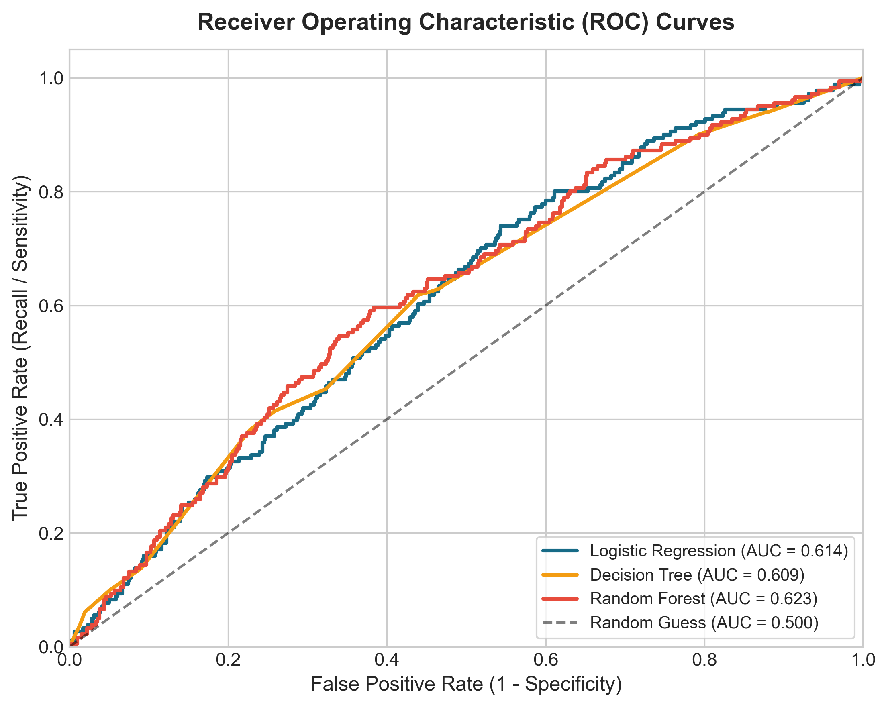
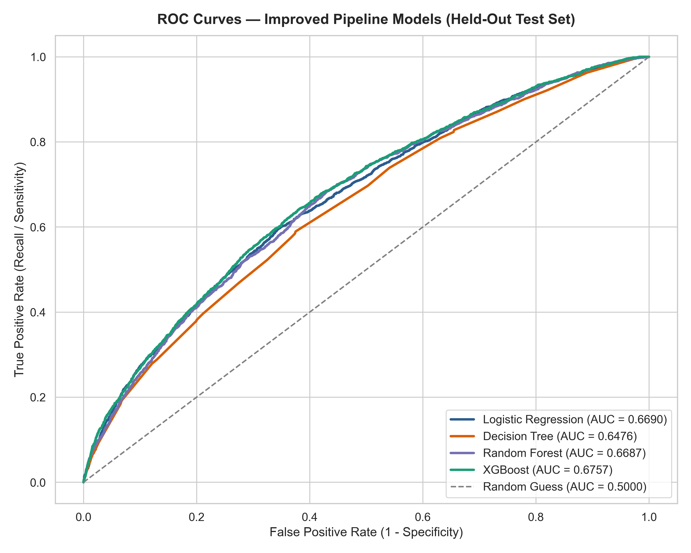
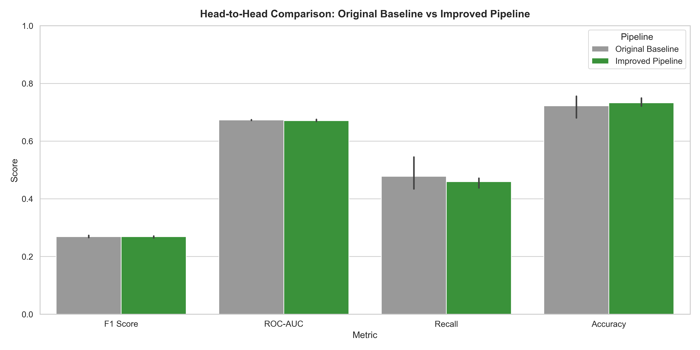
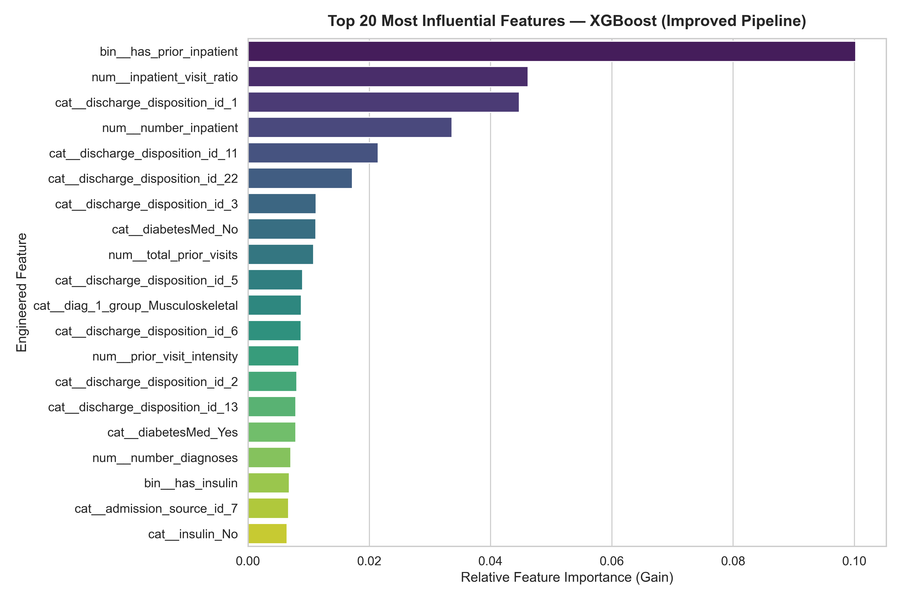
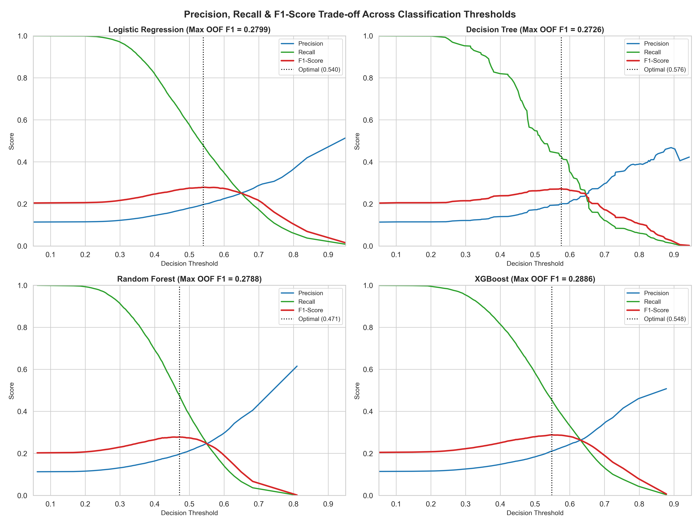

# CarePredict: 30-Day Hospital Readmission Prediction


Machine learning models that predict whether a hospitalised patient with diabetes will be **readmitted within 30 days of discharge**, built on the public *Diabetes 130-US Hospitals (1999–2008)* dataset. The project compares Logistic Regression, Random Forest and XGBoost (plus a Decision Tree in the improved pipeline), uses patient-level splitting to avoid leakage, tunes the decision threshold for imbalanced data, and includes a Streamlit dashboard for exploring results and screening a patient profile.

> **Disclaimer:** This is an academic prototype. It is not validated for clinical use and must not be used to make decisions about patient care.

An accompanying IEEE-format report describes the study in full.

---

## Contents

1. [Results at a glance](#results-at-a-glance)
2. [Dataset](#dataset)
3. [Method](#method)
4. [Class imbalance: weights vs SMOTE](#class-imbalance-class-weights-vs-smote)
5. [Dashboard](#dashboard)
6. [Repository structure](#repository-structure)
7. [Getting started](#getting-started)
8. [Limitations](#limitations)
9. [References and credits](#references-and-credits)

---

## Results at a glance

All numbers are on a held-out test set of **20,153 encounters** (2,151 readmissions, about 10.7%) from patients never seen in training.

**Baseline pipeline** (the models reported in the paper):

| Model | Threshold | Accuracy | Precision | Recall | F1 | ROC-AUC |
|---|---|---|---|---|---|---|
| Logistic Regression | 0.5032 | 0.6805 | 0.1767 | 0.5449 | 0.2669 | 0.6722 |
| Random Forest | 0.5146 | 0.7560 | 0.1959 | 0.4142 | 0.2660 | 0.6735 |
| XGBoost | 0.5376 | 0.7302 | 0.1917 | 0.4751 | 0.2732 | 0.6745 |

**Improved pipeline** (engineered features, cross-validated tuning, out-of-fold thresholds):

| Model | Threshold | Accuracy | Precision | Recall | F1 | ROC-AUC | PR-AUC |
|---|---|---|---|---|---|---|---|
| Logistic Regression | 0.5400 | 0.7276 | 0.1890 | 0.4714 | 0.2698 | 0.6690 | 0.2040 |
| Decision Tree | 0.5755 | 0.7554 | 0.1850 | 0.3794 | 0.2487 | 0.6476 | 0.1813 |
| Random Forest | 0.4714 | 0.7217 | 0.1844 | 0.4695 | 0.2648 | 0.6687 | 0.2010 |
| XGBoost | 0.5480 | 0.7495 | 0.1971 | 0.4384 | 0.2720 | 0.6757 | 0.2123 |

**How to read this:** every model reaches a ROC-AUC of about 0.65–0.68, and the models are close to one another. Predicting 30-day readmission from administrative records is hard, so the differences between models are small compared with the gap to a perfect classifier. Precision is low (about 0.18–0.20): at the chosen thresholds, roughly four in five flagged patients are not readmitted. The "improved" pipeline did not clearly beat the baseline; its main gains are a more careful experimental design and a PR-AUC evaluation.

Full tables are in `results/full_baseline_vs_improved_comparison.csv` and `results/improved_model_comparison.csv`.

| ROC curves (baseline) | ROC curves (improved) |
|---|---|
|  |  |



---

## Dataset

- **Source:** [Diabetes 130-US Hospitals for Years 1999–2008](https://archive.ics.uci.edu/dataset/296/diabetes+130-us+hospitals+for+years+1999-2008), UCI Machine Learning Repository (introduced by Strack et al., 2014).
- **File:** `datasets/dataset1/diabetic_data.csv` (`IDS_mapping.csv` maps the admission and discharge ID codes).
- **Size:** 101,766 encounters, 71,518 unique patients, 50 columns.
- **Target:** `readmitted == "<30"` → 1, otherwise 0. That is 11,357 positive encounters (about 11.2%), so the classes are imbalanced and accuracy alone is misleading.

---

## Method

**Patient-level split.** Many patients have several encounters, so a random row split would put the same patient in both train and test. Both pipelines use `GroupShuffleSplit` grouped by `patient_nbr` (80/20, seed 42), giving 81,613 training and 20,153 test encounters with no patient overlap. All preprocessing is fitted on the training data only.

### Baseline pipeline (`notebooks/model_training.ipynb`)

- Three models: Logistic Regression and Random Forest (200 trees) with `class_weight="balanced"`, and XGBoost (200 trees, depth 5, learning rate 0.1).
- The decision threshold for each model is chosen to maximise F1 on a separate validation split of the training data, then applied once to the test set.

### Improved pipeline (`notebooks/train_improved_pipeline.py`, `notebooks/improved_pipeline.ipynb`)

- **Feature engineering (62 input features):** age midpoint, ICD-9 diagnoses grouped into clinical categories, prior-visit totals and ratios, per-day lab/procedure/medication rates, a clinical-complexity score, medication change counts, and glycemic (A1C and glucose) indicators.
- **Models:** Logistic Regression, Decision Tree, Random Forest and XGBoost. A small set of candidate hyperparameters per model was compared with 5-fold `StratifiedGroupKFold` on the training patients.
- **Thresholds:** chosen from out-of-fold predictions on the precision-recall curve, not from the test set.
- **Metrics:** accuracy, precision, recall, F1, ROC-AUC and PR-AUC. The no-skill PR-AUC equals the prevalence (about 0.11), which is the reference point for the PR-AUC values above.

| Top XGBoost features | Threshold trade-off |
|---|---|
|  |  |

The strongest XGBoost features are prior inpatient history (`has_prior_inpatient`, `inpatient_visit_ratio`, `number_inpatient`) and discharge disposition categories.

---

## Class imbalance: class weights vs SMOTE

The improved pipeline compares cost-sensitive weighting with SMOTE oversampling (`sampling_strategy=0.5`, applied inside the training fold only) on one validation fold of the training data:

| Method | ROC-AUC | PR-AUC |
|---|---|---|
| XGBoost, `scale_pos_weight` | 0.6823 | 0.2206 |
| XGBoost, SMOTE | 0.6738 | 0.2112 |
| Decision Tree, `class_weight="balanced"` | 0.6468 | 0.1887 |
| Decision Tree, SMOTE | 0.6361 | 0.1809 |

Class weighting scored slightly higher than SMOTE for both models and is cheaper, so it is used in the final models. (Source: `results/smote_vs_class_weights.csv`.)

---

## Dashboard

`frontend/app_improved.py` ("CarePredict 2.0") is a Streamlit app that loads the saved models in `models/improved/`. Its eight pages are:

1. Executive Summary
2. Pipeline Improvements
3. Model Comparison & Metrics
4. ROC & PR Curves
5. Confusion Matrices
6. Feature Importance
7. Class Imbalance Analysis
8. Patient Readmission Screener (enter a patient profile, choose a model, get a risk flag using that model's tuned threshold)

It also reads `datasets/dataset1/diabetic_data.csv` and several files in `results/`, so run it from the repository root with those folders in place.

---

## Repository structure

```
.
├── datasets/dataset1/
│   ├── diabetic_data.csv              # UCI Diabetes 130-US Hospitals (main dataset)
│   ├── IDS_mapping.csv                # Admission / discharge ID lookup
│   └── preprocessed_initial.csv       # Output of notebooks/preprocessing.ipynb
├── notebooks/
│   ├── dataset1_analysis.ipynb        # Exploratory analysis
│   ├── preprocessing.ipynb            # Initial cleaning
│   ├── model_training.ipynb           # Baseline: LR, RF, XGBoost + thresholds + SMOTE check
│   ├── improved_pipeline.ipynb        # Improved pipeline, step by step
│   └── train_improved_pipeline.py     # Improved pipeline as a single script
├── frontend/
│   └── app_improved.py                # CarePredict 2.0 dashboard
├── models/
│   └── improved/                      # Saved models, preprocessor, thresholds (used by the dashboard)
├── results/                           # Figures and CSV comparison tables
├── .streamlit/config.toml             # Dashboard theme
└── requirements.txt
```

**Earlier prototype (kept for reference).** The repository also contains an earlier prototype built on a different, synthetic dataset (HLT-005): `data/admissions.csv`, `notebooks/pipeline.ipynb`, `notebooks/train_pipeline.py` and `frontend/app.py`. It is separate from the diabetes work above and its results are not comparable. The top level of `models/` holds a mix of artifacts from both workstreams, so use `models/improved/` for anything related to the diabetes dashboard.

---

## Getting started

**Requirements:** Python 3.10 or newer.

```bash
git clone <your-repo-url>
cd Hospital-Readmission-Prediction
python -m venv .venv
source .venv/bin/activate          # Windows: .venv\Scripts\activate
pip install -r requirements.txt
```

**Run the dashboard** (uses the saved models, no training needed):

```bash
streamlit run frontend/app_improved.py
```

**Retrain the improved pipeline** (regenerates `models/improved/` and the figures and CSVs in `results/`):

```bash
python notebooks/train_improved_pipeline.py
```

**Reproduce the baseline results:** open `notebooks/model_training.ipynb` in Jupyter and run all cells. Start Jupyter from the `notebooks/` folder, because the notebook saves to `../models` and `../results`.

All random seeds are fixed at 42.

---

## Limitations

- **Modest discrimination.** ROC-AUC is about 0.67 for every model. The models rank patients better than chance but are not accurate enough to act on alone.
- **Many false alarms.** Precision is below 0.20, so most flagged patients are not readmitted.
- **Narrow, older data.** The data cover diabetic inpatients at 130 US hospitals from 1999 to 2008 and use ICD-9 coding. Performance on other populations, or on current practice, is unknown.
- **Administrative fields only.** The data have no vital signs, lab values or social factors, which matter for readmission.
- **No external validation.** All results come from one held-out split of one dataset. The test set was not used for tuning or threshold selection, but there is no independent dataset or prospective check.
- **Not a clinical tool.** See the disclaimer at the top.

---

## References and credits

- B. Strack, J. P. DeShazo, C. Gennings, J. L. Olmo, S. Ventura, K. J. Cios, and J. N. Clore, "Impact of HbA1c measurement on hospital readmission rates: Analysis of 70,000 clinical database patient records," *BioMed Research International*, vol. 2014, Art. no. 781670, 2014.
- Dataset: "Diabetes 130-US Hospitals for Years 1999–2008," UCI Machine Learning Repository.

**Authors:** _add the three authors' names here_

**License:** _not yet specified. Add a LICENSE file before sharing publicly._
